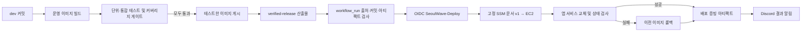

# CI/CD 파이프라인 구현 결과

작성일: 2026-11-08
상태: 로컬 구현 및 단위 검증 완료. GitHub Actions 실제 실행과 EC2 배포는 아직 검증하지 않음.

## 전체 흐름

## 단계별 구현 및 실패 처리

| 단계 | 입력 → 출력 | 실패 처리 및 현재 상태 |
| --- | --- | --- |
| 커밋 | `dev` push와 커밋 SHA | 기존 `Verified application pipeline`이 검사 대상. 이 문서 변경/Task 3 변경은 아직 GitHub에 push하지 않음. |
| 빌드·테스트 | Backend/Frontend 운영 이미지, 임시 PostgreSQL, 합성 데이터·mock 외부 API/LLM → 테스트 결과와 tested-image 식별 정보 | 필수 테스트·커버리지 실패, 취소, 누락/예상 밖 생략은 gate 실패로 처리해 게시/배포를 막는 계약. 기존 CI의 실제 로컬 검증 수치는 아래 참조. |
| 게시·릴리스 | 테스트한 이미지 아카이브 → 동일 이미지의 ECR digest와 `verified-release` (`release.json`) | 검증 gate가 성공하지 않으면 게시하지 않으며, 게시 단계에서 이미지를 다시 빌드하지 않음. |
| 배포 적격성 | 성공한 동일 저장소 `dev` push run 및 해당 run의 `verified-release` → 검증된 배포 요청 | 실패/취소/PR/잘못된 workflow·repository/run, 중복·만료·digest 불일치, 오래된 `dev` HEAD, 허용 시간 밖은 SSM 호출 전에 거부. |
| SSM 배포 | 검증된 SHA/run ID, Backend·Frontend digest, config ID → 고정 `SeoulWave-Deploy-v1` 명령과 command ID | OIDC 역할은 고정 문서·EC2에 한정. 임의 shell 명령, 다른 instance/document는 허용하지 않음. SSM 최종 상태까지 polling. |
| 호스트 적용·검증 | 배포 요청 → Backend, Frontend, itinerary worker, database-health monitor 앱 서비스만 교체 | 잠금/preflight 실패는 변경 없이 종료. 검증 실패 시 이전 이미지 복구를 시도하고 `rolled_back`/`rollback_failed`를 구분. DB migration, 데이터 적재, 관리자 서비스, `.env.prod` 변경은 제외. |
| 증빙·알림 | 원본 run/SHA, 이미지·config ID, SSM 상태, 호스트 검사 결과 → `deployment-evidence` Artifact 및 Discord | 성공은 호스트가 반환한 config ID와 migration dry-run 결과, 4개 loopback HTTP 검사가 모두 일치해야 인정. 원격 stdout/stderr와 비밀값은 증빙·알림에서 제외. |

## 테스트·데이터·차단 기준

- Backend 실행 줄 커버리지 기준: 70% 이상.
- Frontend 실행 줄·문장·함수 각각 70% 이상, 분기 60% 이상.
- CI 테스트는 임시 PostgreSQL과 합성 입력을 사용하고, 외부 API·LLM은 mock 처리한다. 운영 비밀값이나 운영 DB를 테스트에 사용하지 않는다.
- 필수 검사 실패, 커버리지 미달, 취소 또는 예상 밖 검사 생략은 gate 실패로 간주한다. gate 실패 시 이미지 게시와 CD 모두 차단한다.
- 테스트한 이미지의 config 식별 정보와 게시된 ECR 이미지 digest를 대조하고, CI가 테스트한 이미지를 그대로 배포한다.
- 2026-11-07 로컬 Docker Linux 검증 기록: Backend 67개 통과, 줄 커버리지 70.83%; Frontend 36개 통과, 줄/문장 88.14%, 함수 89.57%, 분기 77.21%. 이는 로컬 작업 트리 검증이며 GitHub/ECR/EC2 실행 실적이 아니다.

## 알림·담당·에스컬레이션

- 배포 성공/실패는 기존 Discord Webhook 연동을 사용하도록 구현했다. Slack/Teams/PagerDuty는 추가하지 않았다.
- `workflow_run` 완료 후 알림하는 구조이며, 중간 지연 전용 알림은 없다. SSM polling 제한 초과는 실패 결과로 남겨 최종 Discord 알림 대상이 된다.
- 담당자는 운영자/승인자 임익현, 장애 알림 15분 무응답 시 보조 담당자 박서윤이라는 운영 정보가 대화에서 정해졌으나, 자동 담당자 할당·15분 에스컬레이션은 구현되지 않았다.
- Discord 메시지 전달과 실제 장애 담당 흐름은 GitHub Actions에서 아직 실행해 검증하지 않았다.

## 현재 검증 결과와 남은 작업

- 로컬 pipeline 단위 테스트: 56개 통과.
- Python 컴파일, 배포/IAM/SSM JSON 문법, `git diff --check`: 통과.
- 교차 호스트 artifact redirect 회귀 테스트: 수정 전 Authorization 전달을 재현했고, 수정 후 토큰이 GitHub API 요청에만 전송됨을 확인.
- 배포 시간대는 GitHub run/artifact/head 재확인 후 최신 KST로 재검사한다. Discord Webhook secret이 없거나 전송이 실패하면 알림 step도 실패로 기록한다.
- 독립 코드 리뷰에서 발견한 두 P2(오래된 배포 시각 재사용, Webhook secret 누락을 성공 처리)는 수정 후 별도 회귀 테스트로 확인했고, 리뷰어가 재검토해 두 항목 모두 닫혔으며 추가 P0–P2는 없다고 확인했다.
- `actionlint`와 로컬 YAML parser는 환경에 설치되어 있지 않아 실행하지 않았다. 별도 도구를 설치하지 않았다.
- 2026-11-08 read-only GitHub 확인: 저장소 기본 브랜치는 `dev`이며 현재 SHA는 `413e3ad`; 브랜치 보호는 비활성이다. 이 작업의 로컬 기준 커밋 `1666bff`는 GitHub에서 조회되지 않았다. 따라서 CI→CD 실행 전에 승인된 브랜치 게시/통합과 `pipeline-gate` 필수 상태 설정을 확인해야 한다. `workflow_run`은 기본 브랜치 ref에서 실행되므로 기본 브랜치가 `dev`인 현재 상태는 기존 OIDC `dev` subject와 일치한다.
- 보안상 중요한 차단 사항: 브랜치 보호가 없으면 `dev`에 쓰기 권한이 있는 주체가 필수 CI 검사를 우회하거나 workflow를 바꾸고, 같은 `dev` OIDC subject의 게시/배포 역할을 요청할 수 있다. 실제 권한 영향은 역할 범위로 제한되지만 ECR 게시와 운영 EC2 배포 경로가 연결되어 있으므로, 직접 push로 CD를 시험하기 전에 PR 필수화·필수 `pipeline-gate`·force-push 금지·우회자 제한을 포함한 보호 규칙을 검토해야 한다. 이 GitHub 설정은 자동 변경하지 않았다.
- 이 Task 3 변경을 포함한 GitHub push, 새 GitHub Actions CI→CD 실행, AWS SSM 명령, EC2 배포, 외부 HTTP/실제 브라우저 확인은 아직 하지 않았다. 실제 배포 성공 전에는 README용 GIF를 만들지 않았다.
- 다음 단계는 변경분을 사용자 확인 후 push하고 Actions 종료까지 관찰하는 것, 실행 시간대에 실제 EC2 상태·응답을 검증하는 것, 실제 화면을 캡처해 README GIF로 추가하는 것이다. 브랜치 보호 필수 상태 확인과 Discord 지연/15분 에스컬레이션 설계도 별도 운영 작업이다.
