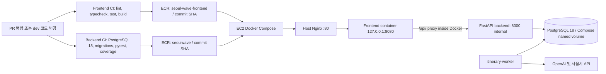

# EC2 운영 배포 준비 및 절차

이 문서는 GitHub Actions가 ECR에 올린 이미지를 EC2에서 실행하기 위한 준비 문서입니다. `compose.yaml`과 개발용 `.env`는 그대로 두고, 운영에는 `compose.prod.yaml`과 EC2에만 보관하는 `.env.prod`를 사용합니다.

2026-11-06 사용자가 SSH로 확인한 현재 상태를 반영했습니다. Codex는 EC2에 접속하거나 서버 설정을 변경하지 않았습니다. 실제 Compose 실행, DB 초기화·마이그레이션, Nginx 적용은 별도 승인을 받기 전까지 수행하지 않습니다.

| 항목 | 확인된 현재 상태 |
| --- | --- |
| 인스턴스 | `dev-stud-server` (`t3.small`), Public IP `13.125.215.42` |
| IAM | Instance Profile Role `ec2-ecr-read`; `sts get-caller-identity` 성공 |
| Backend ECR | `seoulwave:0a662217736ca2f9f348d1806080cdaad87d531d`의 `batch-get-image` 성공 |
| Docker | 실행 중인 컨테이너 없음, Docker Volume 없음, Compose 프로젝트 없음. 이전 프론트 이미지와 종료된 테스트 컨테이너만 존재 |
| Nginx | 호스트에서 80번 포트 사용 중, 현재 upstream은 `127.0.0.1:8000` |
| 자원 | Linux에서 메모리 총량 약 1.9 GiB, available 약 1.4 GiB, swap 없음, 루트 디스크 여유 약 25 GB |

## 구성



프론트엔드 CI는 `dev`에 push됐을 때 검사 성공 후 SHA 태그 이미지를 업로드합니다. 백엔드 CI도 테스트용 PostgreSQL에서 마이그레이션과 pytest·커버리지를 확인하고 통과한 커밋의 이미지를 업로드합니다. 현재 배포 workflow는 EC2에 자동 배포하지 않습니다. EC2에서 Compose 실행은 별도 승인 후 수동으로 합니다.

## 확인된 이미지와 저장소

2026-11-06 사용자가 Backend 이미지의 `batch-get-image` 조회 성공을 확인했습니다. 카카오맵 키 설정 후 commit `605740fa11d75560f31c932b9ffc01e609535864`의 Frontend CI 검사, 이미지 게시, Discord 알림이 모두 성공했습니다.

| 역할 | 저장소 | 확인된 태그 | 확인된 digest | 비고 |
| --- | --- | --- | --- | --- |
| Backend | `seoulwave` | `0a662217736ca2f9f348d1806080cdaad87d531d` | `sha256:881791b49ad472977a7b5cae79361a92535d564744de6ed2e6375eb9440bea28` | Backend CI 성공 후 업로드된 이미지 |
| Frontend | `seoul-wave-frontend` | `605740fa11d75560f31c932b9ffc01e609535864` | `sha256:f1cfbb1639ee25623ceeefcc48e339accaf09df3272d61e4e9c5e8f857c2f28c` | 키 필수 검사 통과 후 빌드·ECR 업로드 성공 |

프론트엔드 Docker 이미지는 Vite 정적 빌드를 포함하므로 카카오맵 JavaScript 키를 **이미지 빌드 시점에** 전달해야 합니다. 새 CI에서는 해당 값이 비어 있으면 ECR 게시를 실패시키며, 현재 표의 `605740fa...` 이미지가 키 필수 검사를 통과해 게시된 이미지입니다. `latest`는 사용하지 않습니다.

EC2의 Instance Profile Role로 ECR 인증이 동작하고 Backend 이미지 조회가 성공했으므로 이 IAM/ECR 경로는 다시 만들 필요가 없습니다. EC2에 장기 AWS Access Key를 저장하지 말고 기존 Instance Profile Role을 사용합니다.

## 운영 Compose와 데이터 보존

- `compose.prod.yaml`은 ECR 이미지 URI를 받아 씁니다. EC2에서 애플리케이션 이미지를 빌드하지 않습니다.
- PostgreSQL은 `postgres:18`이며 호스트에 5432 포트를 공개하지 않습니다. DB가 새로 만들어지는 환경이라 사용자·DB 이름은 이번 배포를 위해 정하고 강한 새 비밀번호를 생성합니다.
- 현재 EC2에는 Docker Volume이 없으므로 `compose.prod.yaml`은 Compose managed named volume `seoul-wave-prod-postgres-data`를 첫 승인된 `up` 때 생성합니다. `external: true`는 기존 볼륨이 없을 때 Compose가 오류를 내므로 제거했습니다. 명시적 `name`은 프로젝트 이름이 달라져도 같은 볼륨 이름을 재사용하게 합니다 ([Docker Compose volume 문서](https://docs.docker.com/reference/compose-file/volumes/)).
- Compose가 만든 named volume은 컨테이너 재생성 때 유지되지만 `docker compose down -v` 또는 `docker volume rm`은 새 DB 데이터를 삭제하므로 사용하지 않습니다. volume이 만들어진 뒤에는 새 배포라고 비밀번호를 바꾸지 않습니다.
- PostgreSQL 공식 이미지 18부터 권장 mount 지점은 `/var/lib/postgresql`이고 `PGDATA` 기본값은 `/var/lib/postgresql/18/docker`입니다. 이 설정은 PostgreSQL 18 경로를 사용합니다. 기존 볼륨이 다른 버전·경로에서 만들어졌다면 먼저 버전과 mount를 조사해야 하며, 이 Compose로 전환한다고 데이터가 자동 이전되는 것은 아닙니다. [Docker Official PostgreSQL Image 문서](https://github.com/docker-library/docs/blob/master/postgres/content.md#pgdata)
- 신규 volume에는 빈 DB가 생성됩니다. API가 DB에 연결돼도 행사·장소·시간표 데이터나 애플리케이션 테이블이 준비됐다는 뜻은 아닙니다. 현재 migration과 초기 데이터 적재는 자동으로 실행하지 않으며 스키마/시드 절차를 확인하고 별도로 승인받아야 합니다.
- DB 네트워크는 Docker 내부 전용입니다. Backend와 worker는 외부 API 호출을 위해 애플리케이션 네트워크에도 연결됩니다.
- 기존 호스트 Nginx가 80번 포트를 사용하므로 frontend 컨테이너만 `127.0.0.1:8080`에 바인딩합니다. backend 8000과 PostgreSQL 5432는 호스트에 publish하지 않고 Docker 네트워크 내부에서만 연결합니다. 외부 공개 포트는 host Nginx의 80번으로 유지합니다.
- 프론트 이미지 내부의 `frontend/nginx.prod.conf`가 `/api/`를 Docker DNS 이름 `backend:8000`으로 전달합니다. 따라서 EC2 host Nginx는 모든 경로를 frontend `127.0.0.1:8080`으로 보내면 되고, 현재 upstream `127.0.0.1:8000`은 바꿔야 루트 URL에서 React 화면이 표시됩니다. [Nginx EC2 설정 예시](nginx-ec2.conf.example) 참고. 변경은 별도 승인을 받은 뒤 적용합니다.
- Backend readiness는 `/ready`에서 `SELECT 1`을 실행합니다. DB 연결 확인이지 전체 테이블·LLM·외부 API·추천 worker 동작 확인은 아닙니다. `/health`는 프로세스 상태만 확인합니다.
- Worker는 기존 `python -m app.itinerary_worker` 명령으로 한 개를 실행하며 재시작 정책을 적용합니다. 코드에 worker 전용 health/heartbeat 신호가 없어 Compose healthcheck를 꾸며 넣지 않았습니다. 실행은 `docker compose ps`와 로그로 확인합니다.

### t3.small 메모리 고려

EC2의 사용자 확인값은 Linux에서 약 1.9 GiB 메모리, 시작 전 available 약 1.4 GiB, swap 없음입니다. `t3.small`은 2 GiB 메모리 사양입니다 ([AWS T3 사양](https://aws.amazon.com/ec2/instance-types/t3/)). Compose에서는 DB·API·worker를 각각 한 개만 실행하고, PostgreSQL을 `shared_buffers=128MB`, `max_connections=30`, `work_mem=4MB`, `maintenance_work_mem=64MB`로 제한해 초기 메모리 압력을 낮춥니다.

API·worker의 실제 최대 RSS를 아직 측정하지 않았으므로 임의의 Docker `mem_limit`을 설정하지 않았습니다. 첫 승인된 실행 때 DB → API·frontend → worker 순서로 올리며 각 단계에서 `free -h`, `docker stats`, `docker compose ps` 및 OOM 로그를 확인해야 합니다. available 메모리가 300 MiB 아래로 내려가거나 OOM 재시작이 보이면 다음 서비스를 올리지 말고 중단해 인스턴스 크기·swap·서비스 메모리 정책을 다시 결정합니다. 현재 25 GB 디스크 여유는 확인됐지만, swap을 추가하는 것도 EC2 상태 변경이므로 승인 전에는 하지 않습니다.

## 운영 환경 변수

실제 파일은 EC2에 `.env.prod`라는 이름으로만 저장합니다. 저장소에 올리지 않습니다. `.env.prod.example`의 `REPLACE_...` 문자열은 문서용 값이므로 모두 실제 승인된 값으로 바꿔야 합니다.

| 변수 | 설정 방법 |
| --- | --- |
| `BACKEND_IMAGE`, `FRONTEND_IMAGE` | 성공한 ECR 업로드에서 확인한 저장소와 40자리 commit SHA 태그 |
| `POSTGRES_DB`, `POSTGRES_USER`, `POSTGRES_PASSWORD` | 새 데이터베이스에 사용할 이름·전용 사용자와 새로 생성한 강한 비밀번호. `.env.prod`에만 저장 |
| `SESSION_SECRET` | 무작위의 32자 이상 값. 실제 비밀값은 EC2 `.env.prod`에만 저장 |
| `SITE_ACCESS_PASSWORDS` | 승인된 접속 비밀번호 목록. 쉼표로 구분하며 실제 값을 문서·로그에 쓰지 않음 |
| `SESSION_COOKIE_SECURE` | HTTPS를 사용자 브라우저까지 적용할 때 `true`. 현재 EC2 Nginx는 HTTP 80만 확인됐으므로, `true` 상태로는 로그인 세션이 유지되지 않음. HTTPS 적용 또는 팀의 명시적 HTTP 시연 정책 결정 전에는 로그인 가능한 서비스로 배포하지 않음 |
| `OPENAI_API_KEY`, `OPENAI_MODEL` | 승인된 OpenAI 키와 모델 식별자 |
| `SEOUL_CULTURE_API_KEY` | 서울시 문화행사 API를 사용할 경우 발급 키 |
| `FERRY_STOP_COORDINATES_JSON`, `EVENT_DESTINATION_RADIUS_KM` | worker 선택 설정. 좌표를 확정하지 않았다면 예시 기본값을 임의로 운영 확정값으로 취급하지 않음 |
| `VITE_KAKAO_MAP_JS_KEY` | 프론트엔드 이미지 **빌드 시** 사용하는 GitHub 저장소 변수. 브라우저에 전달되는 JavaScript 키이므로 Kakao 개발자 콘솔의 허용 도메인을 제한 |

`SESSION_COOKIE_SECURE=true`는 운영 안전 기본값입니다. 현재 확인된 `http://13.125.215.42` 접속 경로에는 TLS가 없으므로 secure cookie가 브라우저에 저장되어도 다음 HTTP 요청에 실리지 않아 로그인이 유지되지 않습니다. 도메인·TLS를 준비하거나, 팀이 시연용 HTTP 위험을 명시적으로 승인한 경우에만 cookie 설정을 별도 결정합니다. 임의로 `false`로 바꾸지 않습니다.

## Nginx 적용 준비

현재 host Nginx는 80번 포트를 사용하면서 기존에는 `127.0.0.1:8000`으로 프록시합니다. Compose는 프론트 컨테이너만 loopback `127.0.0.1:8080`에 공개하고, frontend 컨테이너 안의 Nginx가 `/api/`를 backend 서비스 `backend:8000`으로 전달합니다. 기존 host Nginx의 upstream을 `127.0.0.1:8080`으로 바꾸면 SPA와 API가 같은 host를 거치며 backend 포트를 host에 공개하지 않습니다. 예시의 `server_name` IP는 현재값이므로 IP가 변경되면 기존 server block의 실제 도메인/IP를 유지합니다.

서버에 적용할 때에는 현재 사이트 파일을 백업하고 기존 server block의 proxy location을 수정한 뒤 `sudo nginx -t`를 통과시키고, 승인받은 후에만 reload합니다. 예시 파일을 새 server/default server로 무심코 추가하지 않습니다. Nginx 설치 상태 확인과 설정 검사·적용도 이번 로컬 작업에서는 수행하지 않았습니다.

## 배포 전 읽기 전용 확인

아래 명령은 상태 조회용입니다. 자격 증명이나 `.env` 내용은 출력하지 않습니다. SSH 스냅샷은 사용자가 직접 수행했으며, Codex는 EC2 명령을 실행하지 않았습니다.

로컬 AWS CLI가 연결된 경우:

```powershell
aws sts get-caller-identity
aws ec2 describe-instances --region ap-northeast-2 --filters 'Name=tag:Name,Values=dev-stud-server' --query 'Reservations[].Instances[].{State:State.Name,Type:InstanceType,PublicIp:PublicIpAddress,IamProfile:IamInstanceProfile.Arn,SecurityGroups:SecurityGroups[].GroupId}'
aws ecr describe-images --region ap-northeast-2 --repository-name seoulwave --query 'imageDetails[].{Tags:imageTags,PushedAt:imagePushedAt,Digest:imageDigest}' --output table
aws ecr describe-images --region ap-northeast-2 --repository-name seoul-wave-frontend --query 'imageDetails[].{Tags:imageTags,PushedAt:imagePushedAt,Digest:imageDigest}' --output table
```

EC2에서 SSH 접속 후, 승인된 배포 직전에 다시 읽기 전용으로 확인 (이후 서버 상태가 바뀌었을 수 있음):

```bash
docker --version
docker compose version
sudo docker ps -a --no-trunc
sudo docker volume ls
sudo ss -ltnp
sudo systemctl status nginx --no-pager
df -h /
free -h
sudo docker stats --no-stream
```

컨테이너의 전체 환경 변수, `docker inspect` 전체 JSON, `.env` 파일을 공유하지 마세요. 실제 상태가 사용자 확인 스냅샷과 다르면 작업을 멈추고 컨테이너·볼륨 mount·`PGDATA`·PostgreSQL 버전을 다시 조사합니다.

## 스키마와 마이그레이션

백엔드 CI는 매 실행에서 임시 PostgreSQL 18에 `002`~`006` SQL을 순서대로 적용한 뒤 테스트합니다. 이는 EC2 운영 DB에 적용됐다는 뜻이 아닙니다. 현재 SQL에는 일반 `CREATE TABLE`/`CREATE INDEX`와 `ALTER TABLE ... ADD COLUMN`이 포함되어 있고 공통 migration ledger가 없어, 처음부터 다시 실행하면 이미 존재하는 객체에서 실패할 수 있습니다.

운영 전에는 DB 이름·테이블·컬럼·인덱스와 백업 복구 가능성을 확인하고, 각 migration이 이미 적용됐는지 대조해야 합니다. 운영 데이터 백업, 스키마 차이 보고, 승인 없이 SQL을 실행하지 않습니다. 마이그레이션은 컨테이너 시작 시 자동 실행하지 않습니다.

## 승인 후 배포 절차

이 절차는 실행 안내입니다. 현재 EC2의 기존 서비스 영향과 볼륨을 확인하고 사용자가 승인하기 전에는 실행하지 않습니다.

1. Instance Profile Role과 Backend ECR 조회는 이미 확인했습니다. 인스턴스/역할이 달라진 경우만 재확인하고 long-lived Access Key는 만들지 않습니다.
2. 배포 직전에 컨테이너·볼륨·포트·Nginx·메모리를 다시 기록합니다. 현재 스냅샷에는 컨테이너와 볼륨이 없지만, 상태가 바뀌었으면 계획을 다시 검토합니다.
3. Backend와 Frontend 모두 정확한 SHA 태그를 선택합니다. 현재 키 포함 Frontend SHA는 표의 값입니다.
4. `.env.prod.example`을 EC2 `.env.prod`로 복사하고 신규 DB 이름·사용자·강한 비밀번호 및 애플리케이션 secrets를 채웁니다. `FRONTEND_IMAGE`를 key-enabled SHA로 바꾸고 모든 placeholder를 제거합니다. 파일은 사용자만 읽을 수 있게 보호합니다.
5. 도메인과 TLS 방침을 정합니다. `SESSION_COOKIE_SECURE=true` 상태에서는 HTTP 로그인 세션이 유지되지 않으므로 TLS를 준비하거나, 별도 승인된 HTTP 시연 정책이 있어야 합니다.
6. Compose가 참조하는 이미지 URI, 환경변수 이름, named volume `seoul-wave-prod-postgres-data`를 검토합니다. `docker compose -f compose.prod.yaml --env-file .env.prod config --quiet`로 문법만 검증하며 펼쳐진 전체 config는 출력·공유하지 않습니다.
7. 승인된 이미지 SHA를 `docker compose ... pull`로 가져옵니다.
8. 신규 PostgreSQL volume이 생성되고 빈 DB가 초기화됨을 확인합니다. DB 시작과 schema/data 초기화는 운영 상태 변경이므로 별도 승인받습니다. migration 및 seed는 시작 시 자동으로 실행되지 않습니다.
9. 서비스 시작 승인 후 `up -d db` → 메모리·DB 로그 확인 → `up -d backend frontend` → readiness·메모리 확인 → `up -d itinerary-worker` → 재확인 순서로 진행합니다. available이 300 MiB 아래로 내려가거나 OOM 재시작이 보이면 다음 단계로 가지 않습니다.
10. 기존 Nginx server block을 백업하고 [예시 설정](nginx-ec2.conf.example)처럼 모든 경로를 `127.0.0.1:8080`으로 전달합니다. frontend 컨테이너 Nginx가 `/api/health`와 `/api/`를 Docker 내부 backend로 분기합니다. `sudo nginx -t` 통과 및 변경 승인을 받은 뒤에만 reload합니다. 그 다음 loopback 경로, 외부 URL, HTTPS·로그인·실제 API를 확인합니다. `/ready`만으로 전체 기능 성공을 주장하지 않습니다.

위 명령은 EC2 운영 변경입니다. 이 문서 작성/검증 단계에서는 실행하지 않았습니다.

## 롤백

배포 전 사용 중인 Backend·Frontend SHA와 컨테이너 상태를 기록합니다. 문제가 생기면 `.env.prod`의 Backend·Frontend 이미지 태그만 이전에 검증된 SHA로 되돌리고, 검토·승인 뒤 Compose에서 애플리케이션 서비스만 다시 생성합니다. **DB 볼륨이나 데이터는 롤백 과정에서 삭제·초기화하지 않습니다.** 스키마를 이미 바꿨다면 이미지 롤백만으로 충분하지 않을 수 있으므로 별도 복구 계획이 필요합니다.

`docker compose down -v`, `docker volume rm`, `docker system prune`, DB 초기화 SQL은 사용하지 않습니다.

## 현재 미확인 및 결정 대기

- 서비스 도메인과 HTTPS/TLS 종단점, 이에 따른 Secure 쿠키 설정
- 신규 empty PostgreSQL의 초기 schema와 승인된 데이터 적재 방법
- DB 백업·복구 절차와 운영 migration 이력
- 실제 구동 후 memory high-water와 적정 swap/인스턴스 크기 (현재 스냅샷: 약 1.9 GiB RAM, 1.4 GiB available, swap 없음)

인스턴스·IAM·Backend ECR 조회는 이미 확인되어 재설정 작업에서 제외했습니다. 남은 항목과 배포 SHA·DB 초기화 영향·중단 시간·TLS 방침을 검토한 뒤, 실제 운영 배포 및 migration에 대한 별도 승인을 받습니다.
