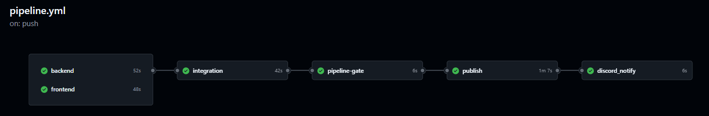
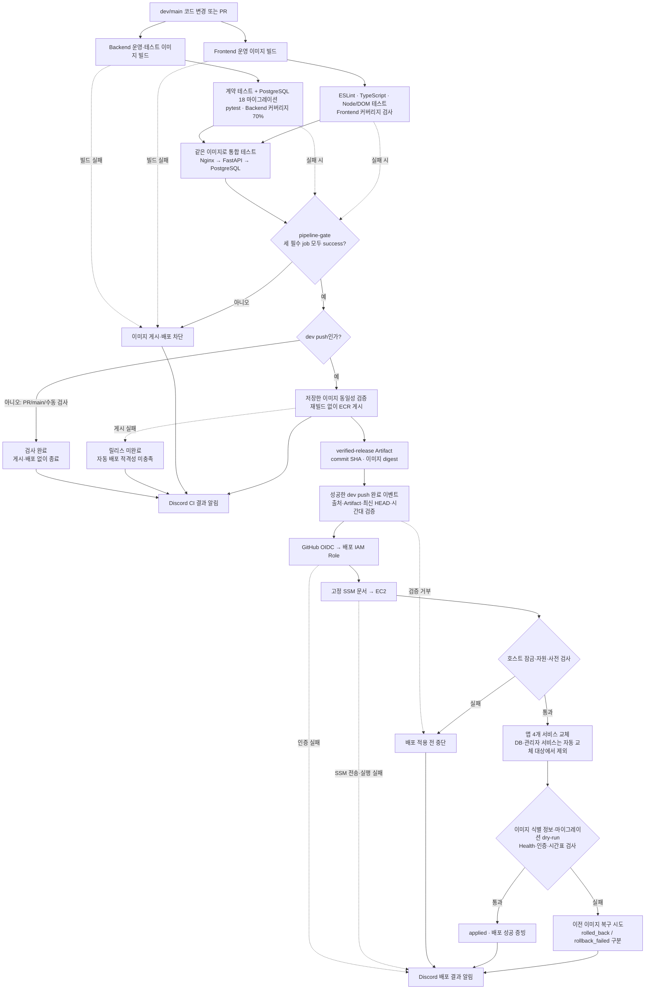
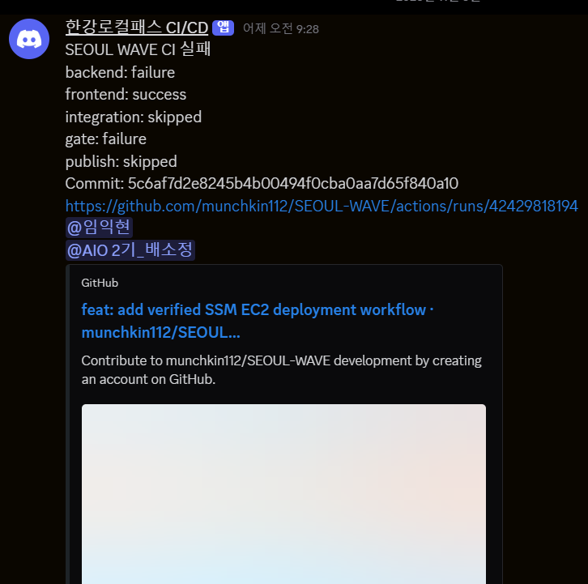
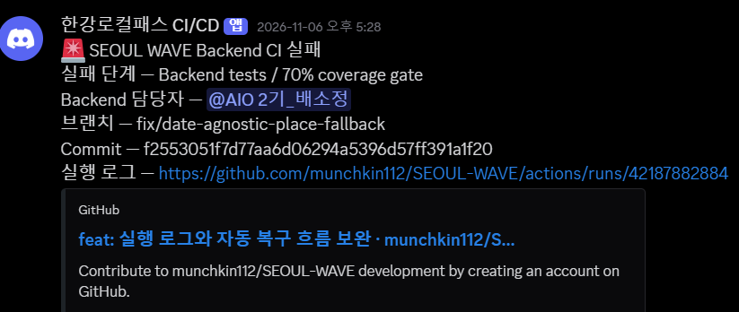
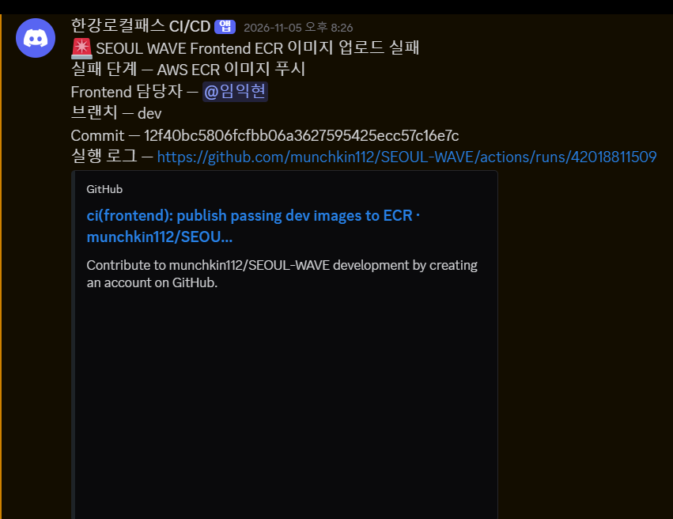
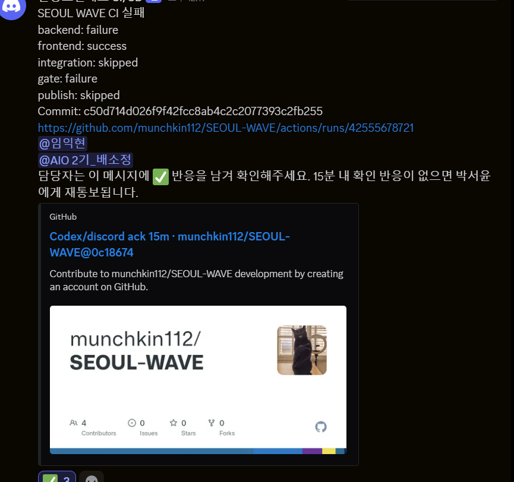
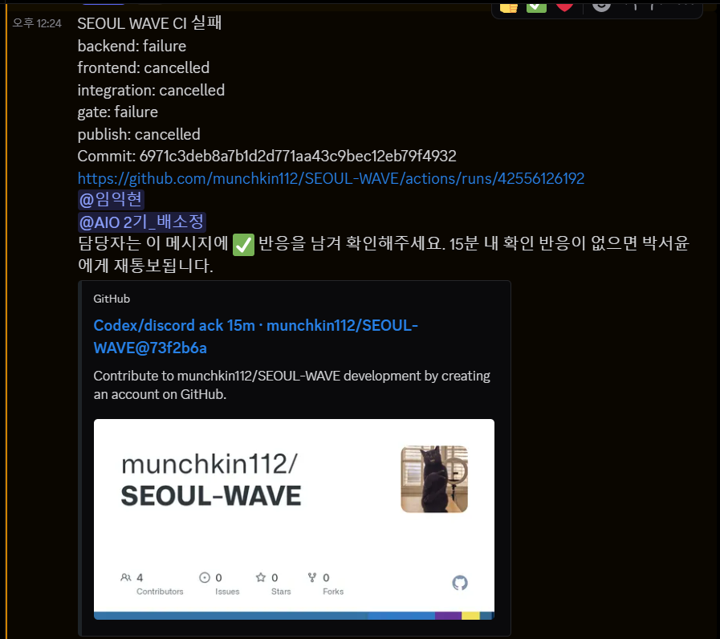
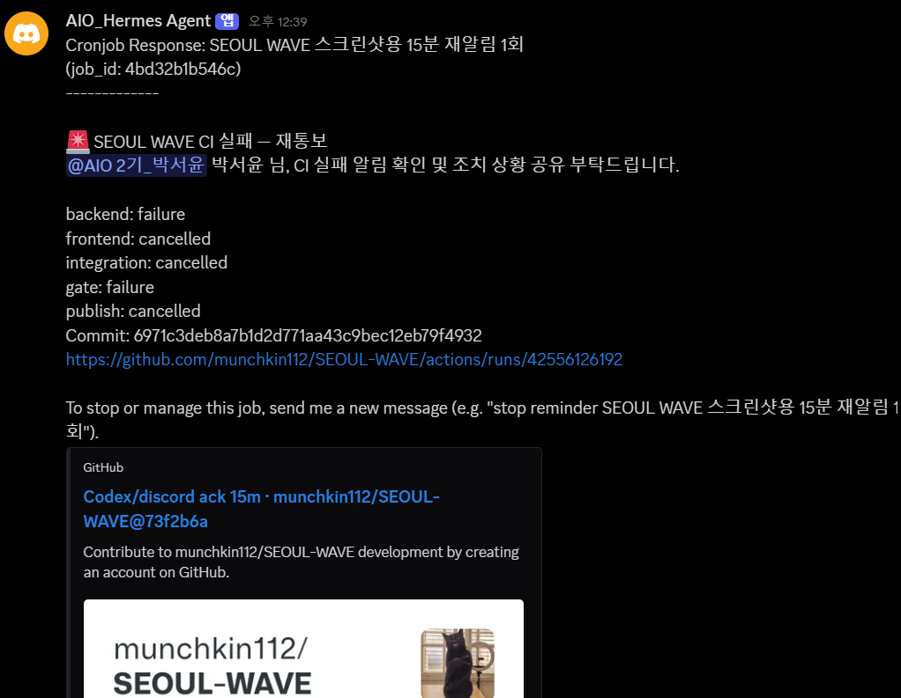

# 1팀 파이프라인 보고서

| 항목 | 내용 |
| --- | --- |
| 프로젝트 | 한강버스 AI 나들이 플래너 · SEOUL WAVE |
| 작성일 | 2026년 11월 9일 |
| 파이프라인·배포 담당 | 임익현 |
| 분석 저장소 | [munchkin112/SEOUL-WAVE](https://github.com/munchkin112/SEOUL-WAVE) |
| 기준 브랜치·커밋 | dev · `5a27ba9c32a7cfbf6125a24c9e9fd3b3c9ed7a29` |
| 검증 근거 | 저장소 워크플로·스크립트, GitHub Actions 로그·Artifact, 사용자 제공 Discord 작업 그래프 및 실제 확인·재통보 화면 8장 |
| 알림 채널 | Discord Webhook |

## 채점 기준별 결론

| 평가 기준 | 결론부터 | 왜 충족하는가 | 확인 방법·증빙 |
| --- | --- | --- | --- |
| ① 커밋→빌드→단위/통합 테스트→배포 단계와 입출력·실패 처리 | **충족** | Backend·Frontend 병렬 검사, 통합 테스트, 필수 gate, 검증 이미지 ECR 게시, SSM 배포·배포 후 검사까지 연결했다. 필수 검사 실패 시 게시와 배포를 막는다. | 3절 파이프라인 도식·단계표, 7.1 성공 실행, 7.2 실패 실행 |
| ② 커버리지·테스트 데이터·실패 차단 정책 | **충족** | Backend 커버리지 70% 기준과 Frontend 기준을 적용한다. DB 테스트는 분리된 PostgreSQL 및 합성 데이터, 외부 API/LLM은 Mock을 사용하며 필수 job 실패는 gate에서 차단한다. | 4절 기준·데이터·gate 설명, 7절 실행 결과 |
| ③ 실행 결과 알림·담당자·에스컬레이션 | **부분 충족** | Discord 성공·실패와 담당자 멘션, ✅ 확인에 따른 종료, 15분 무응답 시 박서윤 멘션까지 실제 시험했다. workflow 자체의 장시간 실행을 별도 경보하는 기능은 확인하지 못했다. | 6절 역할·에스컬레이션 정책, 7.4의 4개 실제 화면. 12:24 실패→12:39 재통보 |

**읽는 순서:** 평가 결과를 먼저 확인한 뒤, 3~5절에서 구현 방식, 6~7절에서 알림 정책과 실행 증빙을 확인할 수 있도록 구성했다. Discord의 이미지 증거는 보고서 본문에 직접 포함했다.
## 1. 구현 결과 요약

본 프로젝트는 코드 변경부터 운영 이미지 빌드, 단위·DB 통합 테스트, 커버리지 검사, ECR 이미지 게시, AWS Systems Manager(SSM)를 통한 EC2 배포 및 배포 후 검증을 연결하였다. 백엔드와 프론트엔드가 모두 검증된 경우에만 이미지 게시와 자동 배포가 진행된다.

2026년 11월 8일 **10:47:01~10:50:09(KST)**에 최신 CI가 성공했고, 이어 **10:50:11~10:51:13(KST)**에 자동 배포가 성공하였다. 이는 과거 수동 배포 기록을 자동 배포 성공으로 간주한 것이 아니라, 최신 GitHub 실행과 해당 실행의 배포 증빙을 직접 확인한 결과다.

| 평가 항목 | 구현·검증 결과 | 판정 |
| --- | --- | --- |
| 커밋→빌드→단위/통합 테스트→배포 흐름, 단계별 입출력·실패 처리 | 통합 CI, 검증된 이미지 게시, SSM CD, 배포 후 검사까지 성공 실행 확인 | 구현 및 성공 실행 확인 |
| 커버리지·테스트 데이터·실패 블로킹 정책 | Backend 70%, Frontend 줄·문장·함수 70%/분기 60%, 독립 DB·Mock, 필수 검사 gate 적용 | 구현 및 실패 차단 확인 |
| 실행 결과 알림·담당자 연계·에스컬레이션 | Discord 성공·실패 알림과 역할별 담당자 연계를 확인했고, ✅ 확인 시 재통보 취소 및 무응답 15분 후 박서윤 멘션도 실제 화면과 시각으로 검증 | 결과 알림·15분 미응답 에스컬레이션 확인 · workflow 실행 지연 전용 알림은 별도 미확인 |

> **평가 기준 ① — 파이프라인 흐름과 실패 처리: 충족.** 커밋에서 테스트·gate·이미지 게시·배포 후 확인까지 이어지고, 필수 단계 실패가 게시와 배포를 막는다. 구성도와 단계별 성공 조건은 3절, 실제 실행은 7절에서 확인할 수 있다.

> **평가 기준 ② — 테스트·커버리지·차단 정책: 충족.** Backend 70% 및 Frontend 커버리지 기준, 격리된 PostgreSQL 테스트 데이터와 외부 API Mock, 실패 시 게시 차단 기준을 4절과 7절 증거로 제시한다.

> **평가 기준 ③ — 결과 알림·담당자·에스컬레이션: 부분 충족.** Discord 성공·실패 알림, 역할별 멘션, ✅ 확인에 따른 재알림 중단, 무응답 15분 후 박서윤 멘션을 실제로 시험했다. 다만 workflow 자체의 장시간 실행 전용 경보는 확인하지 못했다. 시험 화면은 7.4절에 첨부한다.

## 2. GitHub에서 확인한 추가 작업

기존 프론트·백엔드 분리 CI와 수동 EC2 배포에서, 통합 검증 파이프라인과 SSM 자동 배포로 확장되었다. 기존 개별 CI 파일은 삭제하지 않고 수동 진단용 `workflow_dispatch`로 전환하였다.

| 반영일(KST) | 커밋·PR | 변경 내용 |
| --- | --- | --- |
| 11월 7일 | [413e3ad](https://github.com/munchkin112/SEOUL-WAVE/commit/413e3adbc6d7a93128b1b23b22c36e5734dd0ea5) | 통합 CI, Frontend 커버리지, 필수 gate, 테스트한 이미지의 동일성 검증 및 ECR 게시 |
| 11월 8일 | [PR #15](https://github.com/munchkin112/SEOUL-WAVE/pull/15) | 검증된 CI 릴리스에서 SSM 고정 문서로 EC2를 배포하는 CD, 배포 증빙·Discord 결과 알림 추가 |
| 11월 8일 | [PR #16](https://github.com/munchkin112/SEOUL-WAVE/pull/16) | 실제 실행 이미지의 식별 정보 검증 보완 |
| 11월 8일 | [PR #17](https://github.com/munchkin112/SEOUL-WAVE/pull/17) | SSM 실행 단계가 아직 조회되지 않는 초기 구간의 polling 재시도 처리 보완 |

최신 자동 실행의 기준 파일은 [pipeline.yml](https://github.com/munchkin112/SEOUL-WAVE/blob/5a27ba9c32a7cfbf6125a24c9e9fd3b3c9ed7a29/.github/workflows/pipeline.yml), [deploy.yml](https://github.com/munchkin112/SEOUL-WAVE/blob/5a27ba9c32a7cfbf6125a24c9e9fd3b3c9ed7a29/.github/workflows/deploy.yml)이다. 저장소의 기존 `docs/cicd` 문서는 구현 당시의 “실제 배포 미검증” 문구가 남아 있어, 본 보고서는 최신 실행 로그와 Artifact를 우선하였다.

## 3. 전체 파이프라인 구성도

### 3.1 GitHub Actions 실제 작업 그래프

아래는 사용자가 제공한 성공 실행의 **작업 의존성 그래프**다. Backend와 Frontend를 병렬 검사한 뒤 Integration → Gate → Publish → Discord 알림으로 이어지는 실제 CI 구성을 보여 준다.

| 작업 | 첨부 화면의 실행시간 | 상태 | 역할 |
| --- | --- | --- | --- |
| backend | 52초 | 성공 | 백엔드 빌드·테스트·커버리지 및 파이프라인 계약 검사 |
| frontend | 48초 | 성공 | 프론트 빌드·lint·타입·테스트·커버리지 검사 |
| integration | 42초 | 성공 | 동일 이미지의 프록시·인증·API 통합 검사 |
| pipeline-gate | 6초 | 성공 | 필수 세 작업의 성공 여부를 확인해 게시 허용 |
| publish | 1분 7초 | 성공 | 검증한 이미지 ECR 게시와 릴리스 산출물 생성 |
| discord_notify | 6초 | 성공 | CI 결과 Discord 통보 |

표의 시간은 첨부 화면에 표시된 작업별 값이며 병렬 실행 시간을 단순 합산한 전체 소요시간이 아니다. 화면에는 실행 ID가 보이지 않아 특정 run의 캡처로 단정하지 않는다. 최신 성공 run과 배포 증빙은 7절에서 별도로 연결한다. 이 그래프는 CI·이미지 게시 workflow이고, EC2 자동 배포는 별도의 CD workflow에서 이어진다.

### 3.2 CI부터 CD까지의 전체 흐름

PR은 검사 대상이지만 운영 이미지를 게시하거나 배포하지 않는다. 자동 게시는 통합 gate를 통과한 **dev push**에서만 수행한다. 자동 배포는 같은 저장소의 지정된 CI workflow가 **성공한 dev push 실행**인지 확인한 뒤 진행한다.

### 3.3 단계별 입출력과 실패 처리

| 단계 | 입력 | 출력 | 성공 조건 | 실패 시 처리 |
| --- | --- | --- | --- | --- |
| 코드 변경 | dev/main 커밋, PR, SHA | 해당 소스의 workflow 실행 | 허용된 브랜치·이벤트와 SHA로 실행 | 후속 단계는 같은 실행의 결과로 연결. 동시성 제어로 오래된 실행 취소 |
| Backend 빌드·검사 | Python 3.12 소스·의존성·마이그레이션 | 운영 이미지, 테스트 이미지, JUnit·coverage XML | 빌드·계약 검사·마이그레이션·pytest 통과, Backend 커버리지 ≥70% | 하나라도 실패하면 Backend 실패 및 gate 차단 |
| Frontend 빌드·검사 | Node 22, React/TypeScript 소스, JavaScript 지도 키 | 운영 이미지, 테스트·coverage 산출물 | 빌드·lint·타입·테스트 통과, 기준 커버리지 충족 | 하나라도 실패하면 Frontend 실패 및 gate 차단. dev 릴리스 지도 키 누락도 실패 |
| 통합 검사 | 두 빌드의 이미지 아카이브, PostgreSQL 18 | 프록시·인증·API smoke 결과, tested-images.json | 동일 이미지로 Nginx→FastAPI→PostgreSQL 검증 통과 | 선행 검사 실패 시 생략, 자체 실패 시 gate 차단 |
| 필수 gate | Backend·Frontend·Integration job 결과 | 게시 적격 여부 | 세 필수 job이 모두 success | failure·cancelled·skipped·누락은 실패 처리, 게시·배포 차단 |
| ECR 게시 | 검증된 이미지 아카이브와 식별 정보 | 이미지 digest, release.json, verified-release | 테스트 이미지와 게시 이미지 동일성 검증 및 ECR 업로드 성공 | 릴리스 미완료로 표시, CD 적격성 없음 |
| CD 출처 검사 | 성공 CI run, 해당 run의 Artifact, 현재 dev HEAD | 검증된 배포 요청 | 저장소·workflow·SHA·Artifact·시간 검증 통과 | SSM 호출 전에 거부 |
| EC2 적용 | 검증 SHA·digest·config ID, 고정 SSM 문서 | SSM command ID와 호스트 검사 결과 | 적용 후 HTTP·서비스 검사 모두 통과 | 사전 검사 실패 시 중단. 적용 후 검증 실패 시 이전 이미지 롤백 시도 |
| 결과 보관·통보 | CI job 결과 또는 정제된 CD 증빙 | Artifact, Discord 메시지 | 로그·증빙 저장 및 Discord 응답 성공 | CI 실패와 배포 실패를 구분 기록. 롤백 실패도 별도 상태로 기록 |
### 3.4 검증한 이미지와 배포 이미지의 일치

1. Backend의 테스트 이미지는 운영 런타임을 상속하며, 테스트 의존성을 설치할 때 런타임 의존성 버전을 constraints로 유지한다.
2. 각 job에서 운영 이미지를 `docker save`로 보관하고, 통합 job이 그 아카이브를 내려받아 실제 실행한다.
3. 이미지 config의 SHA-256 식별 정보를 `tested-images.json`에 기록한다.
4. 게시 job은 아카이브·커밋·식별 정보를 재확인하고 `docker load`한다. 게시 단계에서 재빌드하지 않는다.
5. ECR manifest의 config 식별 정보를 다시 대조하고, 최종 배포에는 태그 대신 **digest로 고정한 참조**를 사용한다.

근거: [릴리스 검증 계약](https://github.com/munchkin112/SEOUL-WAVE/blob/5a27ba9c32a7cfbf6125a24c9e9fd3b3c9ed7a29/scripts/ci/release_contract.py), [게시 릴리스 생성](https://github.com/munchkin112/SEOUL-WAVE/blob/5a27ba9c32a7cfbf6125a24c9e9fd3b3c9ed7a29/scripts/ci/published_release.py).

## 4. 테스트 기준·데이터 관리·배포 차단

### 4.1 커버리지 기준과 최신 실행 결과

| 대상 | 강제 기준 | 최신 Actions 측정값 | 결과 |
| --- | --- | --- | --- |
| Backend app 실행 줄 | 70% 이상 | **70.83%** | 통과 |
| Frontend 줄 | 70% 이상 | **88.14%** | 통과 |
| Frontend 문장 | 70% 이상 | **88.14%** | 통과 |
| Frontend 함수 | 70% 이상 | **89.57%** | 통과 |
| Frontend 분기 | 60% 이상 | **77.21%** | 통과 |

Backend는 `pytest --cov=app --cov-fail-under=70`, Frontend는 c8의 전체 실행 가능한 `src` 측정과 `check-coverage`를 사용한다. Frontend의 타입 전용 파일·선언 파일만 측정에서 제외한다.

[Backend Dockerfile](https://github.com/munchkin112/SEOUL-WAVE/blob/5a27ba9c32a7cfbf6125a24c9e9fd3b3c9ed7a29/backend/Dockerfile) · [Frontend c8 설정](https://github.com/munchkin112/SEOUL-WAVE/blob/5a27ba9c32a7cfbf6125a24c9e9fd3b3c9ed7a29/frontend/.c8rc.json)

### 4.2 테스트 구성과 정상·장애 대응 구분

| 분류 | 검증 내용 | 근거·범위 |
| --- | --- | --- |
| 정상: Backend | 날짜·시간표·행사 후보·장소 조회·추천 그래프·DB 저장 관련 테스트 | pytest **67개 통과**, failures/errors/skipped 모두 0 |
| 정상: Frontend | 화면 흐름, API 응답 처리, DOM 상호작용, 조건 선택·결과 처리 | Node/DOM 테스트 **36개 통과**, 실패 0 |
| 정상: 통합 | 실제 Nginx 프록시, 로그인, 인증 후 선착장·시간표 API, Backend DB readiness | integration job 성공. smoke는 선착장 목록을 포함한 시간표 API 경로를 검증 |
| 장애 대응: 접근·입력 | 비인증 API 거부, 과거 날짜 거부, 방문 세션·작업 소유권·재생성 제한 | Backend·통합 테스트에 포함 |
| 장애 대응: 인프라·복구 | DB 장애 전환 기록 보존, 오류별 재시도 분류, 재시도 시각과 작업 임대 처리 | Backend 테스트에 포함. 테스트용 DB·Mock 사용 |
| 장애 대응: CI/CD 계약 | 잘못된 SHA·이미지·출처·만료 Artifact·오래된 HEAD 거부, SSM 초기 조회 재시도, 배포 실패·롤백 실패 상태 구분 | 파이프라인 unittest **66개 통과**. 모의 호스트/SSM을 사용한 계약 검증 포함 |

세 테스트 집합은 목적과 실행 환경이 달라 **Backend 67개 / Frontend 36개 / Pipeline 66개**로 구분해 기록한다. 통합 smoke는 별도 실행 스크립트이므로 위 숫자에 임의로 더하지 않는다.

CI의 외부 LLM·서울시 API 경계는 Mock/합성 응답으로 테스트한다. 통합 smoke는 외부 API나 실제 LLM을 호출하지 않는다. 따라서 **이 자동 파이프라인의 통합 성공을 실제 LLM 추천 전체 E2E 통과로 확대하지 않는다.**

### 4.3 테스트 데이터와 비밀값 관리

- CI는 [compose.ci.yaml](https://github.com/munchkin112/SEOUL-WAVE/blob/5a27ba9c32a7cfbf6125a24c9e9fd3b3c9ed7a29/compose.ci.yaml)의 PostgreSQL 18을 사용한다.
- 테스트 DB는 tmpfs에 생성한다. 기존 개발·운영 볼륨, 운영 덤프, 개발용 `.env`와 `.env.prod`를 읽지 않는다.
- CI 전용 DB 계정·비밀번호·로그인 값과 합성 데이터를 사용한다. DB 테스트는 rollback 방식으로 테스트 간 영향을 줄인다.
- CI 스택은 `backend-ci`, `integration-ci` 프로젝트로 분리한다. 검사 후 해당 일회성 CI 자원만 정리한다. CI의 `down --volumes`는 운영 Compose에 적용하는 명령이 아니다.
- AWS 인증은 GitHub OIDC 역할을 사용한다. Discord Webhook은 GitHub Secrets로 전달한다.
- Kakao JavaScript 키는 프론트 빌드 입력이며 브라우저에 제공되는 키다. 운영 OpenAI 키·운영 DB 비밀번호를 CI 테스트 데이터로 사용하지 않는다.

### 4.4 실패 블로킹과 브랜치 정책

- Backend·Frontend·Integration 중 하나라도 실패하면 gate를 통과하지 못한다.
- gate 실패 시 publish가 생략되고 검증된 release Artifact가 생성되지 않으므로 자동 배포로 이어지지 않는다.
- PR은 성공하더라도 게시·배포하지 않는다. main도 검사는 수행하지만 현재 자동 게시·배포 경로는 dev push로 제한한다.
- CD는 현재 dev HEAD와 릴리스 SHA를 다시 비교해 오래된 커밋이 나중에 덮어쓰는 것을 차단한다.
- **파이프라인의 게시·배포 차단과 GitHub의 PR 병합 차단은 별개다.** 병합까지 강제하려면 브랜치 보호/Ruleset에서 필수 상태 검사를 지정해야 한다. 이번 GitHub 연결로 보호 설정을 조회했으나 403이 반환되어 현재 강제 설정 여부는 확인하지 못했다.

## 5. 자동 배포·검증·복구

### 5.1 CD 실행 조건과 대상

성공한 `Verified application pipeline` 완료 이벤트를 받은 `SeoulWave automatic deployment`가 실행된다. 지정된 저장소·workflow·dev push·Artifact·SHA를 검증한 뒤, **KST 09:00 이상 18:00 미만**의 허용 시간대와 최신 HEAD를 재확인한다.

AWS OIDC 역할과 **고정된 SSM 문서/버전·EC2**를 사용한다. SSM 방식이므로 변경된 퍼블릭 IP에 SSH로 접속하는 것을 CD 실행 경로로 사용하지 않는다. 이미지 내려받기와 서버 동작에는 EC2 및 SSM 연결이 정상이어야 한다.

자동 교체 대상은 다음 네 서비스다.

- backend
- frontend
- itinerary-worker
- database-health-monitor

PostgreSQL 데이터베이스, 운영 데이터 적재·마이그레이션 적용, 관리자 API·화면, `.env.prod` 및 호스트 Nginx 변경은 이 자동 교체 대상에 포함되지 않는다. 관리자 이미지 게시 workflow는 별도 운영 범위다.

### 5.2 사전 검사와 배포 후 검사

호스트는 배포 잠금으로 동시 실행을 제한하고, 최소 사용 가능 메모리 300MiB·디스크 여유 1GiB 등의 사전 조건을 확인한다. 이미지 digest와 config 식별 정보를 대조한 뒤 앱 서비스를 교체한다.

성공 판정에는 다음이 필요하다.

| 검사 | 성공 조건 |
| --- | --- |
| 실행 이미지 | Backend·Frontend의 식별 정보가 검증 릴리스와 일치 |
| 마이그레이션 | dry-run 결과에 적용 대기 변경 없음 |
| proxy_health | 실제 프론트 프록시 경유 health 응답 정상 |
| protected_api | 비로그인 보호 API 접근 거부 |
| login | 운영 설정의 비밀번호로 로그인 응답 검증 |
| timetable | 인증 후 선착장·유효 구간 시간표 API 조회 정상 |

이는 EC2 loopback에서 수행되는 자동 HTTP 검사다. 인터넷 외부 브라우저, 지도 렌더링, 실제 LLM 추천 성공은 별도 확인 항목이다.

### 5.3 실패·지연·롤백 처리

- 사전 검사나 잠금 실패는 앱 교체 전 중단하며 `not_applied`로 구분한다.
- 적용 후 검사 실패 시 이전 이미지 참조로 복구를 시도한다.
- 복구 검증 성공은 `rolled_back`, 복구 자체가 실패하면 `rollback_failed`로 구분한다.
- SSM을 10초 간격으로 조회하며 Pending/InProgress/Delayed 등의 중간 상태를 기다린다. 일반 polling 상한은 3,900초, workflow job 상한은 70분이다.
- 아직 SSM 실행 plugin이 조회되지 않는 초기 구간은 최대 120초 동안 재시도하도록 보완했다.
- 중간 지연 상태 자체를 별도로 Discord에 보내지는 않는다. 시간 초과나 최종 실패가 확정되면 실패 알림 대상으로 처리한다.

위 내용은 **workflow 실행 지연** 처리에 관한 것이다. 담당자 미응답 15분 후 재통보는 별개의 외부 AIO_Hermes 자동화로, 6.3절에서 실제 시험 결과를 제시한다.

롤백 기능은 코드·모의 호스트 테스트에서 확인했다. **이번에 내려받은 성공 배포 증빙만으로 운영 서버에 장애를 강제로 주입하고 실제 롤백까지 시험했다고 주장하지 않는다.**

근거: [배포 요청·polling](https://github.com/munchkin112/SEOUL-WAVE/blob/5a27ba9c32a7cfbf6125a24c9e9fd3b3c9ed7a29/scripts/deploy/dispatch.py), [호스트 배포·복구](https://github.com/munchkin112/SEOUL-WAVE/blob/5a27ba9c32a7cfbf6125a24c9e9fd3b3c9ed7a29/scripts/deploy/host_deploy.py).

## 6. Discord 알림·담당자 연계·에스컬레이션

### 6.1 역할별 담당자

| 역할 | 담당자 | 현재 확인된 자동 연계 범위 |
| --- | --- | --- |
| 에이전트 | **박서윤** | 에이전트 장애 분석 담당. 현재 GitHub CI/CD 알림 코드의 직접 멘션 대상은 아님 |
| 백엔드 | **배소정** | `DISCORD_BACKEND_ID` 기반 CI 실패 멘션 |
| 배포 | **임익현** | 배포 결과 Discord 공지 및 운영 대응 담당. 현재 CD 메시지는 전용 담당자 멘션을 추가하지 않음 |
| 프론트엔드 | **임익현** | `DISCORD_FRONTEND_ID` 기반 CI 실패 멘션 |

담당자와 역할은 사용자가 제공한 팀 배정이다. GitHub 저장소에서 확인한 자동 멘션 동작과 별도의 Discord 봇·외부 자동화를 구분한다.

### 6.2 통보 내용과 실제 전달

CI 알림에는 Backend/Frontend/Integration/Gate/Publish 결과, 커밋 SHA, 실행 링크가 포함된다. 실패 조합에 따라 프론트·백엔드 담당자 ID를 멘션한다. 순수 Frontend 실패는 프론트 담당, 순수 Backend 실패는 백엔드 담당, 그 외 실패 조합은 양쪽 담당을 선택한다. Backend 실패로 Integration이 생략되고 Gate까지 실패한 경우 양쪽이 멘션될 수 있으며, 제공된 첫 화면에서도 이 동작이 확인된다.

CD 알림에는 성공/실패, 커밋, 원본 CI 실행 링크, SSM command ID·최종 상태, 적용 결과 또는 정제된 실패 코드가 포함된다. 원시 원격 stdout/stderr와 운영 비밀값은 메시지에 포함하지 않도록 필드를 제한한다.

| 알림 종류 | 검증 결과 |
| --- | --- |
| 최신 CI 성공 | `discord_notify` 성공, **Discord HTTP 204** |
| 최신 CD 성공 | 배포 알림 step 성공, **Discord HTTP 204** |
| 실제 CI 실패 | 사용자 제공 Discord 화면과 실패 실행의 Gate/Publish 상태 대조 |
| 실제 CD 실패 | [실패 실행](https://github.com/munchkin112/SEOUL-WAVE/actions/runs/42433731035)에서 `ssm_poll_failed`, Discord 전송 **204** 확인 |
| workflow 실행 지연 중 별도 알림 | 현재 GitHub 코드에서 확인되지 않음. timeout 등 최종 실패 통보와 구분 |
| 담당자 15분 미응답 시 재통보 | 외부 AIO_Hermes 자동화 실증: ✅ 확인 시 재알림 없음. 무응답 사례는 12:24 CI 실패 후 12:39 박서윤 멘션, 이어 12:41 CI/CD 앱 후속 알림 |

Webhook HTTP 204는 Discord가 메시지를 수신했다는 뜻이며 담당자가 읽거나 조치를 완료했다는 뜻은 아니다. CI 알림은 fork PR에서 제외되고, Webhook Secret이 없으면 전송을 생략하는 현재 코드의 제한이 있다. CD는 Secret 누락이나 전송 실패를 알림 step 실패로 기록한다.

### 6.3 15분 확인·재통보 동작과 검증 범위

담당자가 실패 알림에 ✅를 남기면 해당 알림의 재통보를 중단하고, 15분 동안 반응이 없으면 외부 자동화(AIO_Hermes)가 서브 담당자 박서윤을 멘션해 재통보한다. 이 동작은 GitHub Actions 코드가 아니라 Discord 봇·외부 자동화에서 실행된다. 저장소 CI/CD는 원본 실패 알림과 실행 정보를 제공하고, 외부 자동화가 확인 반응과 경과 시간을 기준으로 후속 멘션을 수행한다.

실제 시험은 두 경우로 구분했다.

1. **확인 완료 시험:** 담당자가 원본 실패 알림에 ✅를 남겼다. 확인 반응이 기록됐고, 15분 후 에스컬레이션 메시지는 발송되지 않았다.
2. **미응답 시험:** 12:24에 CI 실패 알림이 발생했다. 제한 시간 동안 확인 반응이 없자 12:39에 AIO_Hermes가 박서윤을 멘션했다. 시작 시각에서 15분 경과한 시각과 일치한다. 12:41에는 한강로컬패스 CI/CD 앱의 후속 재통보도 도착했다.

두 번째 시험에서 Hermes가 12:39에 1차 에스컬레이션을 보냈고, 프로젝트 CI/CD 봇이 12:41에 후속 알림을 보냈다. 따라서 “15분 후”는 12:39 Hermes 알림을 기준으로 기술하며, 12:41 앱 알림은 추가 전달로 구분한다.

**처리 흐름:** CI/CD 실패 알림 → 담당자에게 ✅ 확인 기회(15분) → 확인 시 종료·재통보 없음 / 미확인 시 AIO_Hermes가 박서윤 멘션 → CI/CD 앱 후속 알림
## 7. 실제 실행 결과와 실패 차단 증빙

### 7.1 제출용 최종 실행 스냅샷

| 항목 | 확인 결과 |
| --- | --- |
| 기준 커밋 | `5a27ba9c32a7cfbf6125a24c9e9fd3b3c9ed7a29` |
| CI 실행 | [42435729165](https://github.com/munchkin112/SEOUL-WAVE/actions/runs/42435729165), 2026-11-08 10:47:01~10:50:09 KST (약 3분 8초) |
| CD 실행 | [42435954788](https://github.com/munchkin112/SEOUL-WAVE/actions/runs/42435954788), 2026-11-08 10:50:11~10:51:13 KST (약 1분 2초) |
| Backend 테스트·커버리지 | pytest 67/67 통과, 70.83% |
| Frontend 테스트·커버리지 | 테스트 36/36 통과, 줄·문장 88.14%, 함수 89.57%, 분기 77.21% |
| 파이프라인 계약 테스트 | 66/66 통과 |
| 통합·Gate·Publish | 모두 성공 |
| CD 결과 | SSM `Success`, `remote_outcome=applied`; 배포 후 login/protected_api/proxy_health/timetable 검사 통과 |
| Discord | CI·CD 알림 각각 HTTP 204 수신 확인 |
| 총 소요 | CI 시작부터 CD 완료까지 약 4분 12초 |

| 실행 | 주요 결과 | 근거 |
| --- | --- | --- |
| CI · 42435729165 | Backend·Frontend·Integration·Gate·Publish·Discord 모두 success | [GitHub Actions](https://github.com/munchkin112/SEOUL-WAVE/actions/runs/42435729165) |
| CD · 42435954788 | SSM Success, remote_outcome=applied, deployment_status=success | [GitHub Actions](https://github.com/munchkin112/SEOUL-WAVE/actions/runs/42435954788) |

다운로드한 `deployment-evidence.json`의 주요 값:

| 항목 | 확인 값 |
| --- | --- |
| source_sha | `5a27ba9c32a7cfbf6125a24c9e9fd3b3c9ed7a29` |
| source_run_id | `42435729165` |
| ssm_command_id | `b8f2d6b2-6db3-477d-8765-c57af62cb3ac` |
| deployment_status / ssm_status / remote_outcome | `success / Success / applied` |
| migration_dry_run | `none` |
| HTTP 검사 | login / protected_api / proxy_health / timetable 모두 `passed` |
| Backend ECR digest | `sha256:5667a9dbde46b23bb8de85c33c8ddb7d23f1eb07adcedb9774d5649bc181a48b` |
| Frontend ECR digest | `sha256:5abd6a2523201871881a6f6f6fdfc504d0806a1e4d6d3da624e896485e83ca01` |

### 7.2 실제 실패 실행

| 사례 | 관찰 결과 | 보고서 해석 |
| --- | --- | --- |
| [CI 42429818194](https://github.com/munchkin112/SEOUL-WAVE/actions/runs/42429818194) | Backend job의 `Verify release contracts`에서 계약 테스트 5개 실패. Frontend 성공, Integration 생략, Gate 실패, Publish 생략, Discord 성공 | 필수 job 실패가 게시·배포를 차단함. 여기서 Backend failure는 앱 pytest 실패가 아니라 해당 job 안의 **배포 계약 테스트 실패**였음 |
| [Backend CI 42187882884](https://github.com/munchkin112/SEOUL-WAVE/actions/runs/42187882884) | 제공된 Discord 화면에 pytest/70% coverage gate 단계 실패와 배소정 멘션 기록 | 과거 Backend 검사 단계 실패 알림 증빙. 이 화면만으로 pytest 실패와 커버리지 미달을 구분하지 않으며 최신 성공 실행과 구분 |
| [Frontend CI 42018811509](https://github.com/munchkin112/SEOUL-WAVE/actions/runs/42018811509) | 제공된 화면에 Frontend ECR 이미지 푸시 실패와 임익현 멘션 기록 | 이미지 게시 실패도 테스트 실패와 구분해 알렸던 과거 증빙. 화면만으로 상세 AWS 원인을 단정하지 않음 |
| [CD 42433731035](https://github.com/munchkin112/SEOUL-WAVE/actions/runs/42433731035) | CI는 통과했으나 CD polling 단계에서 `ssm_poll_failed`로 실패, Discord 204 | CI 성공과 배포 성공을 구분. 후속 PR #17의 초기 SSM 조회 재시도 보완 후 최신 CD 성공 확인 |

### 7.3 Discord 수신 화면

아래 이미지는 사용자가 제공한 실제 수신 화면이다. 현재 통합 workflow 증빙과 이전 개별 CI 증빙을 구분했다.

**그림 1. 통합 CI 실패 → Gate 차단 → Publish 생략 및 담당자 멘션**

**그림 2. 이전 Backend CI의 pytest·커버리지 검사 단계 실패 및 담당자 알림**

**그림 3. 이전 Frontend ECR 이미지 업로드 실패 및 담당자 알림**

### 7.4 15분 확인·무응답 시험 증빙

| 시험 | 시작·결과 | 관찰 결과 | 증빙 |
| --- | --- | --- | --- |
| 확인 반응 있음 | 담당자가 실패 알림에 ✅ 반응 | 확인 반응이 표시되고, 해당 건에 대한 15분 후 재통보는 발생하지 않음 | 그림 5 |
| 확인 반응 없음 | CI 실패 12:24 → Hermes 재통보 12:39 | 15분 경과 시 AIO_Hermes가 서브 담당자 박서윤을 멘션. 이후 12:41에 CI/CD 앱 후속 알림도 도착 | 그림 6, 7, 8 |

**그림 5. 확인 ✅를 남겨 재알림이 취소된 사례**

**그림 6. 확인 반응 없이 대기한 원본 CI 실패 알림 — 12:24**

**그림 7. 15분 후 AIO_Hermes가 박서윤에게 멘션 — 12:39**

**그림 8. CI/CD 봇 후속 재통보 — 12:41**

이 증빙은 **담당자 확인 반응과 15분 무응답 에스컬레이션**을 보여준다. GitHub workflow 자체의 실행시간 초과 경보나 병합 차단을 증명하는 자료로 해석하지 않는다.
## 8. 증빙 보관과 제출 범위

| 산출물 | 보관 위치·기간 |
| --- | --- |
| Backend/Frontend 운영 이미지 아카이브 | Actions Artifact · 7일 |
| Backend JUnit·coverage XML, Frontend coverage, Integration 로그 | Actions Artifact · 30일 |
| tested-image-manifest, verified-release | Actions Artifact · 30일 |
| deployment-evidence | CD Actions Artifact · 30일 |
| 본 보고서 동봉 자료 | JUnit·커버리지 요약·릴리스·배포 증빙 JSON, 기존 Discord·Actions 증거 4장, 15분 응답/무응답 시험 증거 4장 |

Artifact의 보관 기간이 지나면 GitHub 다운로드가 만료될 수 있으므로 제출용 증빙은 이번 보고서와 함께 별도 보관한다. API 키·Webhook URL·운영 비밀번호는 동봉하지 않는다.

본 보고서 작성에서는 GitHub와 저장된 Artifact를 조회했으며 코드를 변경하거나 workflow 재실행, 새 배포, 장애 주입을 수행하지 않았다.

### 남은 제한·별도 확인 항목

1. **workflow 실행 자체의 지연 경보:** 실행이 예상 시간보다 오래 진행 중일 때 별도로 알리는 기능은 GitHub 저장소에서 확인하지 못했다. 이 항목은 담당자 미응답 15분 재통보와 다른 기능이다.
2. **자동 Issue 할당:** Discord 멘션은 확인했으나 GitHub Issue에 담당자를 자동 지정하는 동작은 확인하지 않았다.
3. **PR 병합 강제 보호 규칙:** 현재 적용 상태는 검증하지 않았다.
4. **실서버 롤백 훈련:** 실제 운영 장애를 발생시켜 이전 이미지로 복구하는 시험은 이번 증빙에 포함되지 않는다.
5. **서비스 범위:** 실제 LLM 추천·외부 지도 표시·관리자 서비스 자동 교체는 이 통합 CI/CD가 보장하는 범위를 넘어 별도 검증·운영한다.

## 9. 평가 기준에 대한 최종 정리

| 평가 항목 | 보고서 근거 | 판정 |
| --- | --- | --- |
| ① 커밋→빌드→단위/통합 테스트→배포 단계, 단계별 입출력·실패 처리 | 3절의 구성도·성공 조건·실패 처리와 7절의 CI/CD 성공 및 실패 실행 증빙 | 충족 |
| ② 커버리지 기준·테스트 데이터·실패 블로킹 | 4절의 기준, 데이터 격리, 필수 gate와 실패 시 게시 차단 증빙 | 충족 |
| ③ 성공/실패/지연 알림·담당자·에스컬레이션 | Discord 성공·실패 알림, 역할별 담당자 멘션, ✅ 확인 시 취소, 15분 미응답 후 박서윤 재통보를 실제 화면으로 확인. workflow 장시간 실행 전용 알림과 GitHub Issue 자동 할당은 미확인 | 부분 충족 |

평가 기준 1·2는 코드와 실제 Actions 실행으로 충족을 확인했다. 기준 3은 Discord 결과 통보와 역할별 담당자 연결, 그리고 외부 AIO_Hermes 자동화의 15분 무응답 재통보를 두 가지 실제 시험으로 확인했다. 단, workflow 실행 지연 전용 경보와 GitHub Issue 자동 할당은 확인되지 않아 부분 충족으로 판정한다.
